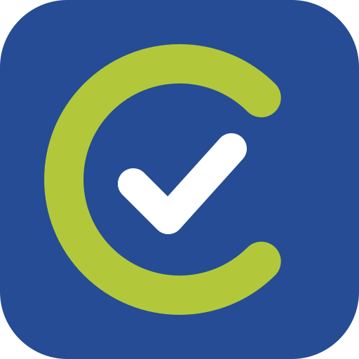
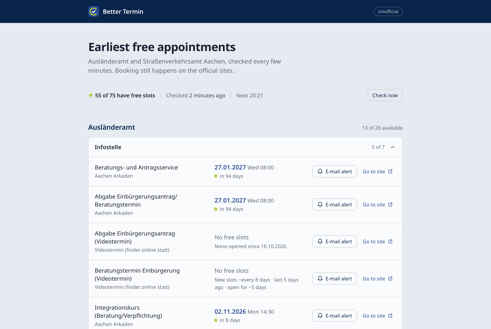
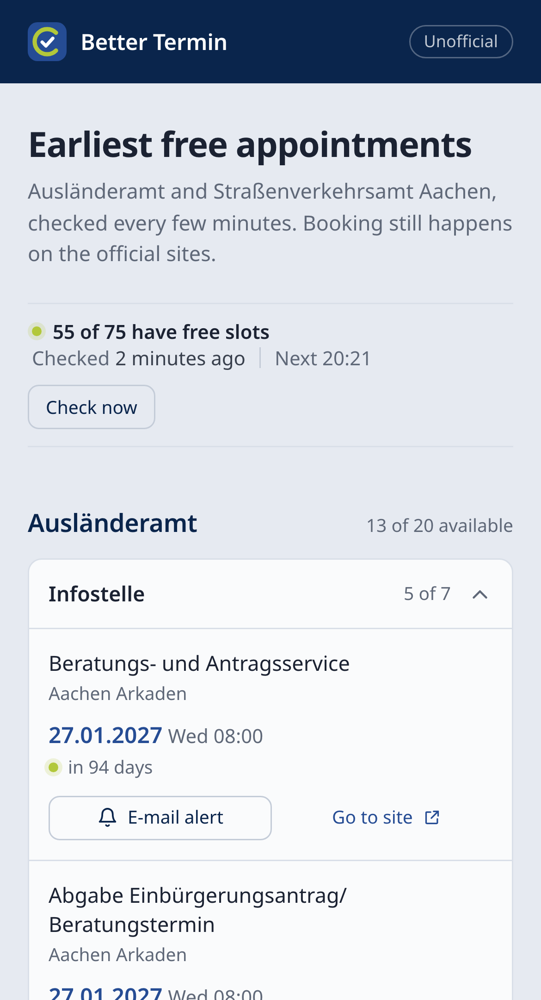

  

<h1 align="center">Better Termin</h1>

  The earliest free appointments at the Städteregion Aachen, in one place. 
  <a href="https://bettertermin.com"><strong>bettertermin.com</strong></a>

  
  &nbsp;&nbsp;
  

## What it does

- **Earliest slot for every appointment type.** One page instead of clicking through each type on the official booking sites, checked every few minutes.
- **How often new slots open.** For types that are fully booked, it shows how often slots have opened, when the last one did and how long they stayed free, based on what it has observed.
- **E-mail alerts.** Get an e-mail when a slot opens or an earlier one appears. Alerts start only after you confirm them, and every e-mail has a link to stop them.

Better Termin only reads the official sites. It never books anything; you still book the appointment there.

## What it covers

| Office | Appointment types |
|---|---|
| [Ausländeramt](https://termine.staedteregion-aachen.de/auslaenderamt/) | Residence and citizenship services, invitations, EU citizens, RWTH and FH Aachen students and staff, pick-ups |
| [Straßenverkehrsamt](https://termine.staedteregion-aachen.de/) | Vehicle registration in Würselen, driving licences in Würselen, vehicle registration and driving licences in Monschau |

New appointment types and offices on these sites are picked up automatically.

## How it works

Both offices use the TEVIS booking system. For each appointment type, Better Termin opens the same pages a visitor would and reads the first free slot; it stops reading there, so it doesn't download the full list of slots. The two offices are checked in parallel, sharing one session per round. If an official site is down, it waits longer between tries until the site is back.

The site runs on a small home server, published through a Cloudflare Tunnel.

## Privacy

- No cookies, analytics or tracking; fonts are served from the site itself.
- IP addresses aren't logged.
- E-mail addresses are used only for the alerts and are deleted when an alert is removed.

Details are in the [privacy policy](https://bettertermin.com/privacy).

## Disclaimer

Better Termin is an unofficial, non-commercial project and is not affiliated with the Städteregion Aachen or its offices. Dates may be out of date; the official booking sites are always authoritative.

## License

[MIT](LICENSE). The bundled Noto Sans fonts are under the [SIL Open Font License 1.1](static/fonts/OFL.txt).
